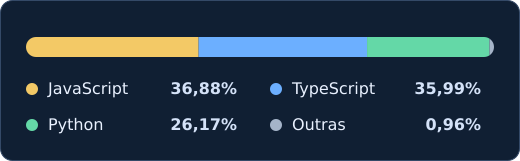

<h1 align="center">José Fernando de Lima Amorim</h1>

  <strong>Advisory Associate na KPMG</strong> 
  Power Platform · React · TypeScript · Recife, PE

  <a href="https://meu-portfolio-three-chi.vercel.app/">Portfólio</a> ·
  <a href="https://www.linkedin.com/in/jos%C3%A9-fernando-lima-amorim/">LinkedIn</a> ·
  <a href="mailto:josefernando.vagas@gmail.com">E-mail</a>

## Sobre mim

Sou formado em Análise e Desenvolvimento de Sistemas pelo Senac-PE. Na KPMG, desenvolvo aplicações corporativas com Power Apps Code Apps, React e TypeScript. Meu trabalho inclui integrar dados do Dataverse e do SharePoint, automatizar notificações com Power Automate e otimizar telas de consulta com filtros e paginação na fonte de dados.

Minha trajetória também inclui uma residência tecnológica em SAP MM pela Deloitte e pelo Porto Digital, além da experiência com TOTVS como jovem aprendiz na A&B Alimentos e Bebidas.

## Tecnologias

**Microsoft Power Platform**

   

**Desenvolvimento web**

   

**APIs e dados**

   

**Integração e versionamento**

  

## Projetos em destaque

- **[Portfólio pessoal](https://github.com/limaamorim/Meu-Portfolio)** · Site em React e TypeScript com minha trajetória e meus projetos.
- **Amigo Edu** · Plataforma de indicações educacionais com acompanhamento de recompensas e ranking. [Frontend em React](https://github.com/limaamorim/AmigoEdu-frontend) · [API em Node.js](https://github.com/limaamorim/Proleduca_Backend)
- **[Sistema de apoio ao diagnóstico termográfico](https://github.com/limaamorim/ProjetoIntegradorBackend)** · Projeto integrador em Python e Django com simulação de exames e geração de laudos em PDF.

### Linguagens dos projetos em destaque

Proporção dos bytes de código que o GitHub atribui a cada linguagem nos quatro repositórios acima. Retrato de novembro de 2026.

## Certificações Microsoft

- **PL-900** · Power Platform Fundamentals
- **AZ-900** · Azure Fundamentals
